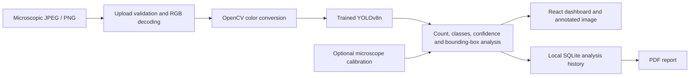

# Machine Learning Framework for Microplastic Detection in Water

## Abstract

This software prototype applies a fine-tuned YOLOv8n detector to microscopic images of prepared wastewater samples. It detects suspected microplastic fragments, reports their locations and confidence, counts detections, estimates bounding-box dimensions and exports a PDF analysis. A React dashboard is backed by FastAPI and persistent SQLite analysis records. A reproducible Jupyter notebook documents data preparation, training, validation, test evaluation and inference. The system supports the fragment class present in its selected dataset and does not chemically identify polymer composition.

## Objectives

1. Train a detector from real annotated microscope images rather than use hand-tuned contour rules.
2. Evaluate on a held-out split and preserve actual precision, recall and mAP measurements.
3. Provide image upload, visualization, particle analysis and report generation in an accessible dashboard.
4. Distinguish model predictions, calibrated dimensions and demonstration count thresholds from validated laboratory measurements.

## Architecture

## Dataset and methods

The Microplastic-Fragments-WWTP-Dataset published by andreusv on Hugging Face contains 2,010 microscopy images. The source describes prepared samples from a wastewater-treatment plant in Valencia, Spain. Its supplied partitions contain 1,406 training, 302 validation and 302 test images. The annotations contain 2,915, 790 and 852 fragment bounding boxes respectively.

The pipeline decodes Parquet image data, converts COCO xywh boxes to normalized YOLO center xywh coordinates and maps foreground category 1 to class 0 (`microplastic_fragment`). Images are resized proportionally to at most 1280 pixels. No exact source-image hash duplicates were found across the partitions. Near duplicates and shared acquisition conditions are not ruled out by this exact-hash audit.

YOLOv8n starts from pretrained Ultralytics weights and is fine-tuned at image size 640, batch size 12 and seed 42 for up to 40 epochs, with early-stopping patience 12. The best checkpoint is selected using validation performance. The test images are withheld from training and selection. Training/evaluation records are stored alongside the model; measured final results appear in `MODEL_EVALUATION.md` and `ml/evaluation/metrics.json`.

## Analysis and user workflow

The user uploads a valid microscope image and selects a confidence threshold. The API produces one record per predicted bounding box. Class distribution is calculated from those records, and total count equals the number of detections. Width, height and area are reported in pixels. If the user supplies a valid microscope calibration in micrometers per pixel, physical bounding-box dimensions and area are calculated from that factor.

Low/Moderate/High bands use configurable image detection-count thresholds: below 10, 10-29, and at least 30 respectively. They are demonstration thresholds and do not indicate water safety or concentration. The dashboard displays original and annotated images, summary cards, class distribution, detection tables and historical results. A PDF contains saved analysis details, the annotated image, detection table, calibration information and interpretation limitations.

## Validation

The final verification covers real held-out-image inference, record/count agreement, valid box coordinates, calibration and uncalibrated measurements, PDF generation, persistent history, no-detection handling, unsupported/corrupt files, file and pixel limits, invalid thresholds/calibration, missing-model behavior, CORS and the React workflow. See `TESTING_REPORT.md` for actual outcomes and `output/verification` for artifacts.

## Limitations

The supported dataset class is **microplastic fragment**. Fiber and bead detection, polymer classification, forecasts and pollution-source attribution are not validated by these data. Microscopy appearance alone cannot prove that a particle is plastic. False positives can arise from visually similar organic debris, and small/overlapping particles may be missed. A model trained on this acquisition protocol may generalize poorly to other microscopes, sample preparations or environmental domains. Confidence scores are not overall accuracy, and bounding-box area is not particle contour area. Test metrics on 302 images provide evidence for this dataset only.

## Future work

Expand annotations to additional particle shapes and diverse microscopes; evaluate external geographic/sample-preparation domains; collect chemically confirmed labels; calibrate confidence and count error; add contour segmentation for physical shape measurements; and integrate laboratory sample volume/filter metadata for defensible concentration estimates.

## References

- User-supplied *Microplastic Detection PRD v1.0*, included as `Microplastic_Detection_PRD.pdf`.
- andreusv. *Microplastic-Fragments-WWTP-Dataset*. https://huggingface.co/datasets/andreusv/Microplastic-Fragments-WWTP-Dataset ; CC BY 4.0. See included dataset card and attribution.
- Ultralytics. *YOLOv8 software and pretrained models*. https://github.com/ultralytics/ultralytics ; AGPL-3.0.
